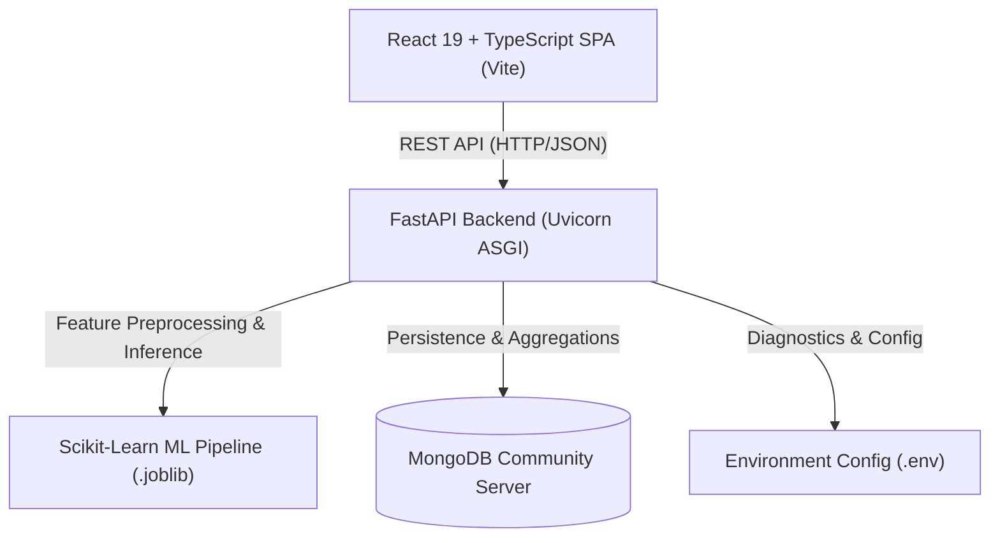
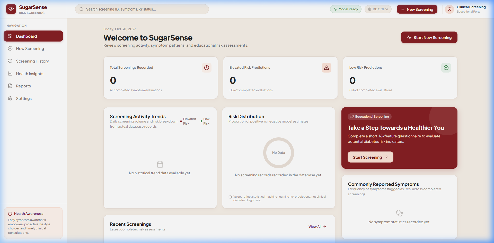
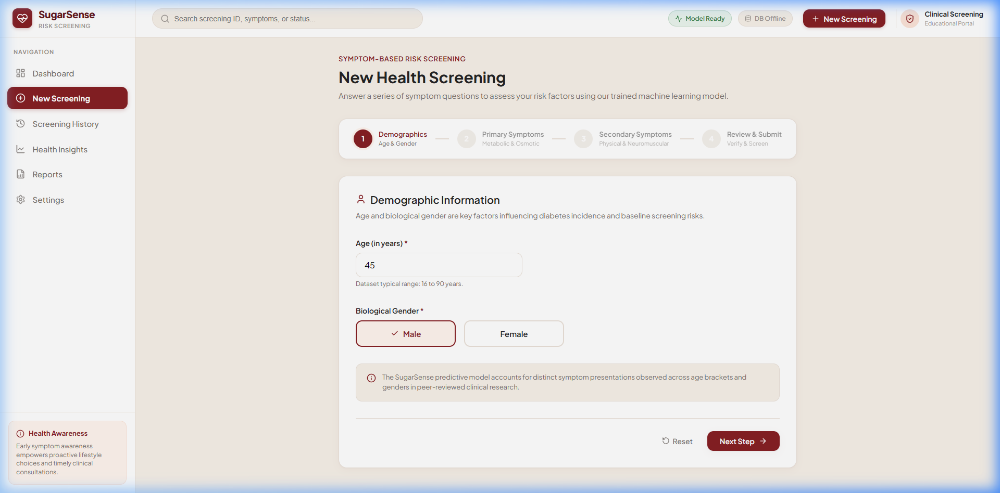

# SugarSense — Diabetes Risk Screening & Health Insights

SugarSense is an educational symptom-based diabetes risk-screening web application. Powered by modern machine learning and built with a high-performance stack, SugarSense allows individuals to enter age, gender, and 14 symptoms to receive an immediate algorithmic risk screening assessment, view epidemiological feature correlations, and track an auditable history of past screenings.

> [!IMPORTANT]
> **Educational Disclaimer**: SugarSense is designed strictly as an educational and preliminary risk-screening aid. It is **not** a clinical diagnostic system, medical device, or substitute for professional medical advice, diagnosis, or treatment. Predicted risk categories and model confidence scores reflect statistical associations within the training dataset and must never be interpreted as medically calibrated probabilities or individual clinical determinations.

---

## Key Features

- **Interactive 4-Step Risk Screening**: Intuitive symptom assessment questionnaire with step-by-step progress tracking, client-side validation, and review summary before submission.
- **Machine Learning Inference**: Real-time risk classification using an empirical scikit-learn Decision Tree pipeline with class probability distribution and risk scoring.
- **Executive Analytics Dashboard**: Aggregate screening statistics, elevated vs. low risk proportions, and top reported symptom frequencies calculated dynamically from persisted records.
- **Auditable Screening History**: Chronological table of past screenings with search, risk category filtering, pagination, and detailed single-screening modal inspection.
- **Algorithmic & Health Insights**: Interactive symptom correlation matrix and risk distribution charts comparing user findings with dataset benchmarks.
- **Executive PDF-Ready Reports**: Formal summary report generator formatted for patient record documentation and clinical consultation discussions.
- **Resilient Offline Architecture**: Fully functioning fallback and graceful degradation when MongoDB is disconnected, with real-time connectivity status indicators.

---

## Technology Stack

| Layer | Technologies |
| :--- | :--- |
| **Frontend** | React 19, TypeScript, Vite 6, Lucide React Icons, Vanilla CSS Design System |
| **Frontend Testing** | Vitest, React Testing Library, JSDOM |
| **Backend API** | Python 3.11+, FastAPI, Pydantic v2, Uvicorn (ASGI) |
| **Machine Learning** | scikit-learn 1.5+, pandas 2.2+, NumPy 2.0+, Joblib |
| **Database** | MongoDB Community Server 7.0+, PyMongo 4.8+ |
| **Backend Testing** | Pytest 8.3+, FastAPI TestClient, HTTPX |
| **Containerization** | Docker, Docker Compose, Nginx Alpine |

---

## Architecture Overview



1. **Frontend**: Clean single-page application built with custom CSS variables and glassmorphism cards. Communicates with backend endpoints via typed API client (`frontend/src/services/api.ts`).
2. **Backend**: Asynchronous REST API organizing routes into `/api/v1/predict`, `/api/v1/model-info`, `/api/v1/screenings`, and `/api/v1/stats`.
3. **Machine Learning Pipeline**: Custom scikit-learn `Pipeline` utilizing `ColumnTransformer` (standard scaling for numeric `Age`, one-hot encoding for binary symptoms and gender) feeding into a tuned `DecisionTreeClassifier`.
4. **Database Storage**: MongoDB collection `screenings` indexed by `created_at` descending for low-latency pagination and aggregations.

---

## Dataset Information & Model Evaluation

### Dataset Summary
- **Source**: Early Stage Diabetes Risk Prediction Dataset (`data/diabetes_data_upload.csv`).
- **Observations**: 520 instances (320 positive, 200 negative).
- **Features**: 16 predictor features (1 numeric `Age`, 1 categorical `Gender`, and 14 binary symptom features).
- **Target**: `class` (`Positive` or `Negative` risk).

### Dataset Limitations
- The dataset reflects symptom reporting from a specific hospital study cohort.
- Data consists exclusively of demographic and subjective symptom indicators; no laboratory measures (e.g., HbA1c, fasting plasma glucose, oral glucose tolerance test) are included.
- Not representative of all global demographics, sub-types of diabetes (Type 1, Type 2, gestational), or asymptomatic early presentations.

### Actual Model Training Evaluation Results
The active production model artifact (`backend/ml/saved_model/sugarsense_model.joblib`) was trained using an 80/20 stratified train/test split (416 train rows, 104 held-out test rows, `random_state=42`):

| Evaluation Metric | Cross-Validation (5-Fold Mean) | Held-Out Test Set (104 samples) |
| :--- | :--- | :--- |
| **Accuracy** | 96.39% | **99.04%** |
| **Positive Class Recall (Sensitivity)** | 96.86% | **98.44%** |
| **Positive Class Precision** | 97.30% | **100.0%** |
| **F1-Score (Positive Class)** | 97.04% | **0.9921** |

#### Test Set Confusion Matrix (Held-out Test Cohort)
- **True Negatives (TN)**: 40
- **False Positives (FP)**: 0
- **False Negatives (FN)**: 1
- **True Positives (TP)**: 63

*Clinical Tradeoff Rationale*: In preliminary health screening applications, false negatives (failing to detect risk) carry significantly higher harm than false positives. The Decision Tree model was selected for near-zero false negatives while maintaining 100% precision on the held-out split.

---

## API Documentation

FastAPI provides interactive OpenAPI/Swagger documentation at `http://127.0.0.1:8000/docs` and ReDoc at `http://127.0.0.1:8000/redoc`.

| Method | Endpoint | Description | Status Codes |
| :--- | :--- | :--- | :--- |
| `GET` | `/` | Application root status and API metadata | 200 |
| `GET` | `/health` | Service health, loaded model confirmation, MongoDB status | 200, 503 |
| `GET` | `/api/v1/model-info` | Model metadata, feature schema, test evaluation metrics | 200, 503 |
| `POST` | `/api/v1/predict` | Validate questionnaire, run ML model, persist screening | 200, 422, 503 |
| `GET` | `/api/v1/screenings` | Paginated screening history (`limit`, `offset`) | 200, 503 |
| `GET` | `/api/v1/screenings/{id}` | Retrieve individual screening record by MongoDB ObjectId | 200, 400, 404, 503 |
| `GET` | `/api/v1/stats` | Dynamic aggregate statistics and symptom reporting frequency | 200, 503 |

---

## Environment Configuration

### Backend (`backend/.env`)
Copy `backend/.env.example` to `backend/.env`:
```dotenv
APP_ENV=development
API_HOST=127.0.0.1
API_PORT=8000
FRONTEND_ORIGIN=http://localhost:5173
CORS_ORIGINS=http://localhost:5173,http://127.0.0.1:5173,http://localhost:3000
MONGODB_URI=mongodb://localhost:27017/
MONGODB_DATABASE=sugarsense
```

### Frontend (`frontend/.env`)
Copy `frontend/.env.example` to `frontend/.env`:
```dotenv
VITE_API_BASE_URL=http://127.0.0.1:8000
```

---

## Local Development Setup

### Prerequisites
- Python 3.11+
- Node.js 18+ and npm
- MongoDB Community Server (optional for transient mode, required for persistence)

### 1. MongoDB Setup
Ensure MongoDB is running locally on port 27017:
- **Windows Service**: `Start-Service -Name MongoDB`
- **Manual Daemon**: `mongod --dbpath <path_to_data_folder>`

### 2. Backend Setup
```bash
cd backend

# Create and activate virtual environment
python -m venv venv
# On Windows PowerShell:
.\venv\Scripts\Activate.ps1
# On Linux/macOS:
source venv/bin/activate

# Install dependencies
pip install --upgrade pip
pip install -r requirements.txt

# Start backend dev server
uvicorn app.main:app --reload --host 127.0.0.1 --port 8000
```

### 3. Frontend Setup
```bash
cd frontend

# Install dependencies
npm install

# Start Vite development server
npm run dev
```
Open [http://localhost:5173](http://localhost:5173) in your browser.

---

## Testing & Quality Assurance

Both frontend and backend include comprehensive unit, validation, and integration test suites.

### Backend Testing (Pytest)
From `backend/`:
```bash
# Run complete test suite (41 tests)
.\venv\Scripts\pytest -v

# Run with coverage report
.\venv\Scripts\pytest --cov=app --cov=ml
```
Tests cover:
- Health check and model availability degradation (503).
- Model information endpoint and metric disclosures.
- Prediction validation (strict 1–120 age range, categorical schemas, forbid extra fields).
- Boundary conditions (Age 1 and 120 valid; Age 0 and 121 rejected).
- Extreme symptom combinations (all positive, all negative).
- MongoDB failure resilience and 503 graceful handling.
- Screening persistence, pagination, ObjectId hex validation, 404 handling.
- Dynamic statistics calculations and symptom ranking.
- Empirical test metric verification matching `model_metadata.json`.

### Frontend Testing (Vitest & React Testing Library)
From `frontend/`:
```bash
# Run all Vitest test suites (20 tests across 5 files)
npm test

# Run Vitest in watch mode
npm run test:watch

# Verify TypeScript compilation and production bundle
npm run build

# Run linter
npm run lint
```
Tests cover:
- Dashboard KPI cards, symptom frequencies, recent records rendering, and retry handling.
- Step-by-step questionnaire navigation, field validations, submission, and error alerts.
- Prediction result display, score visualization, and risk factor badges.
- Screening history table, risk status filtering, and modal detail inspection.
- App layout navigation and responsive sidebar behavior.

---

## Production Deployment

### Option A: Docker Compose (Recommended)
Launch the complete stack (MongoDB Community + FastAPI ASGI + Nginx Vite SPA) with a single command:
```bash
docker-compose up --build -d
```
- Frontend application: [http://localhost:3000](http://localhost:3000)
- Backend API: [http://localhost:8000](http://localhost:8000)
- MongoDB Database: `localhost:27017`

### Option B: Standalone Production Services

#### Production Backend (Uvicorn ASGI)
```bash
cd backend
uvicorn app.main:app --host 0.0.0.0 --port 8000 --workers 4 --proxy-headers
```

#### Production Frontend (Vite Build + Static Host)
```bash
cd frontend
# Set production API URL
export VITE_API_BASE_URL=https://api.yourdomain.com
npm run build
# Serve dist/ folder using Nginx, Caddy, or Cloudflare Pages
```

---

## Application Screenshots

| Dashboard Overview | Step-by-Step Screening Questionnaire |
| :---: | :---: |
|  |  |

| Risk Screening Results | Auditable Screening History |
| :---: | :---: |
|  |  |

---

## License & Compliance

This software is distributed under the MIT License for educational and research evaluation purposes only. No medical warranty, diagnosis, or clinical certification is provided or implied.
